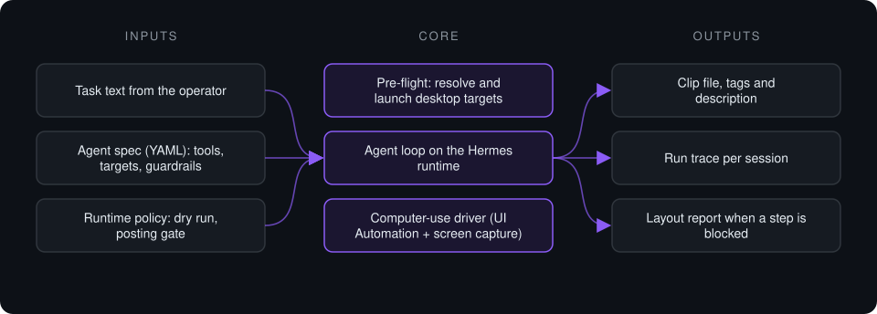

# ClipHunter

**Computer-use agent that operates a desktop video app end to end: finds a source, drives the app's real UI, and stops at a hard posting gate.**

> **This is a proprietary project. Source code is private. This page showcases the system's architecture and capabilities.**

**Case study page:** [https://jryahia.github.io/showcase-cliphunter/](https://jryahia.github.io/showcase-cliphunter/)

**Status:** Prototype. Runs in dry-run mode, which halts before any publishing step.

## Problem it solves

Clip Agent Pro has no public API for its full workflow, and much of the clipping pipeline lives behind a desktop UI. ClipHunter treats that UI as the integration surface: an agent reads the live window through accessibility data and screenshots, acts on numbered elements rather than guessed pixel positions, and records every step it took. Publishing is blocked by configuration until a human turns it on.

## Architecture

1. The launcher reads the agent spec, resolves the desktop app and browser executables, and refuses to start if a required target is missing.
2. The agent searches for one source video and returns its URL.
3. It opens the desktop app, reads the window as a numbered element tree plus screenshot, and pastes, scrolls and clicks by element index.
4. Every state-changing action is re-captured to confirm it landed; two failed attempts end the run with a written layout report.
5. Posting steps run only when dry run is off and posting is explicitly enabled.

## Key features

- Accessibility-tree targeting instead of fixed screen coordinates
- Verify-after-act loop on every state-changing action
- Hard posting gate: two independent config flags must both allow it
- Pre-boot gate that resolves executables from an ordered candidate list
- Per-run trace logs and a structured layout report on failure
- Self-test and tree commands for checking the setup without running the agent

## Tech stack

    

## What it does in practice

- Turns a manual click-through of a desktop app into a scripted, logged agent run.
- When the UI changes or a control is unreachable, the run stops and explains where, instead of clicking blind.

---

Built by [Yahya Jarray](https://github.com/jryahia). Interested in a similar system? [Get in touch](mailto:yahiajarray43@gmail.com).

This repository contains no source code. It is a case study for a proprietary project. © Yahya Jarray.
